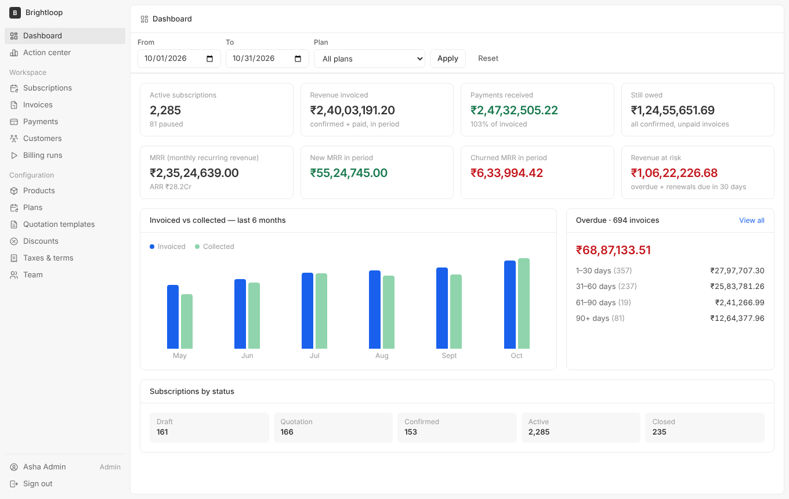
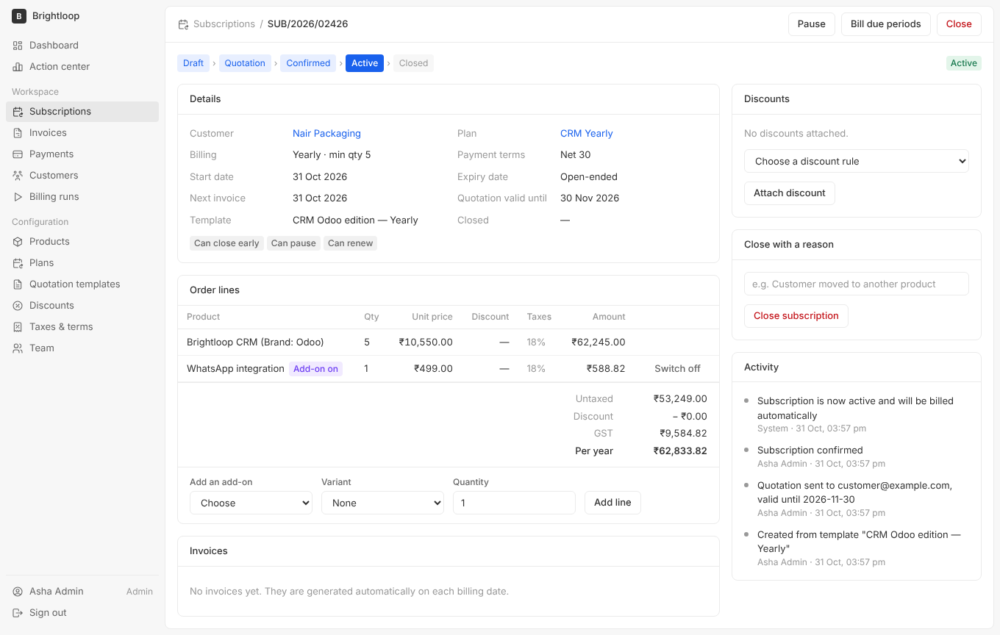
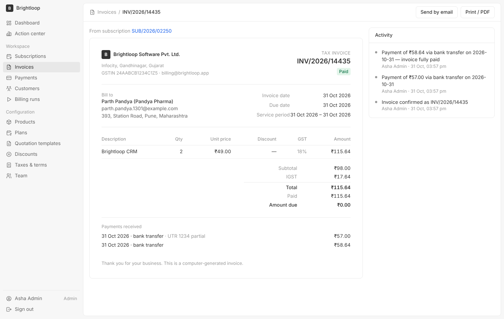
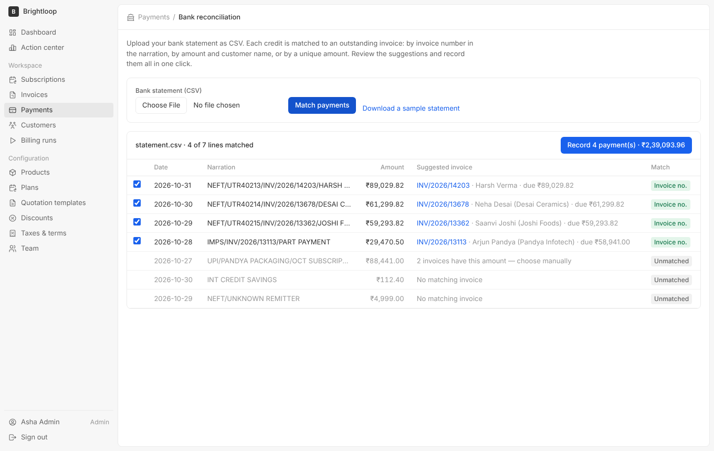
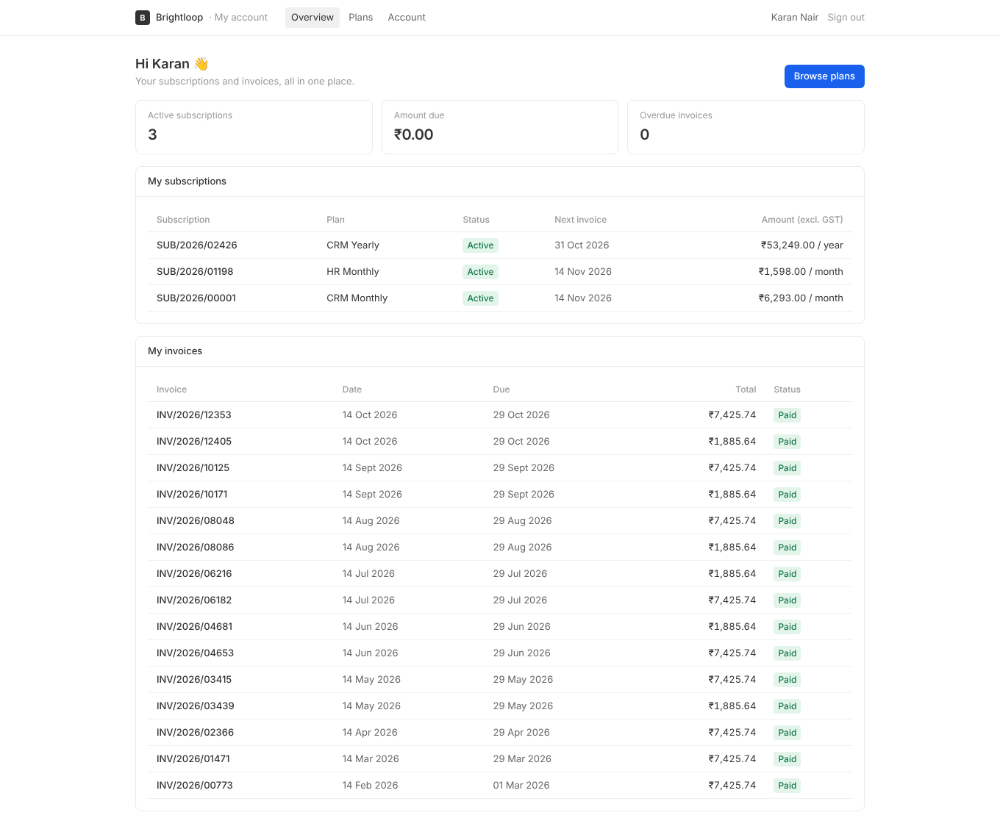
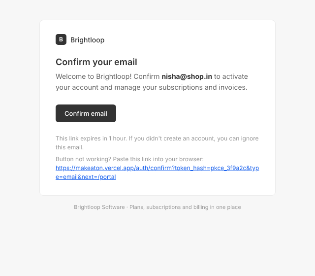
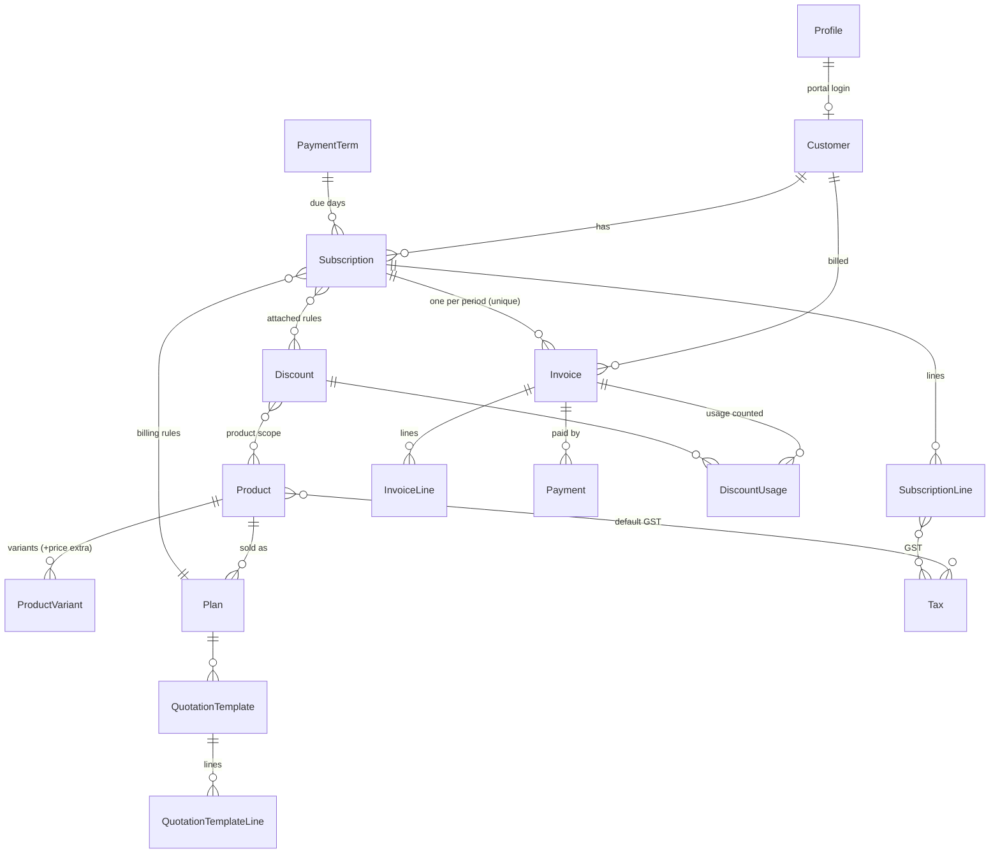

# Brightloop: Subscription Management System

**Live demo:** https://makeaton.vercel.app

## Team

- Aman Xavier (@AxZyzz): product, demo video and deployment.


One system to run **plans, subscriptions, recurring billing, payments and revenue reporting** for a subscription business, built for the Odoo hackathon problem statement *"Subscription Management System"*.

**Stack:** Next.js 15 (App Router, Server Actions) · TypeScript · PostgreSQL (Supabase) · Prisma · Supabase Auth · Tailwind CSS · Vitest. All amounts are in **₹ with GST**.

> Demo logins (password `Brightloop@2026`): `admin@example.com` · `staff@example.com` · `customer@example.com`

---

## How each scene in the brief is solved

| Scene in the brief | What the system does |
|---|---|
| **A new customer signs up** | Email + password sign-up with **one account per email** (case-insensitive). Password must be **more than 8 characters** with upper, lower and special characters, shown as a live checklist and enforced on the server. **Real emails** go out for sign-up confirmation, password reset links, email change confirmation and "password changed" notices. Three roles: **Admin** (everything), **Staff** (day-to-day, no configuration), **Customer** (portal, own records only). **Only the admin can invite staff.** |
| **Launching a new plan** | Products with name, type, sales and cost price, notes and default GST. **Variants** with a price extra (*Brand: Odoo → +₹560*). Plans with price, **daily/weekly/monthly/yearly** billing, **minimum quantity**, **availability dates**, and per-plan options: **auto-close at expiry, closable, pausable, renewable**. |
| **Turning a quote into a subscription** | **Quotation templates** (plan, product lines, payment terms, **validity in days**). Subscriptions have number, customer, plan, start/expiry dates and payment terms; lines show product, qty, unit price, taxes and amount. Lifecycle **Draft → Quotation → Confirmed → Active → Closed**, shown as a status bar, with pipeline counts and an audit timeline visible to the whole team. Expired quotations cannot be confirmed. |
| **Billing day** | A **billing run** creates an invoice for every due period of every active subscription, with customer details, lines, discounts, **GST (CGST+SGST or IGST)** and totals filled in. Invoices go **Draft → Confirmed → Paid**; staff can **confirm, cancel, email or print** them. **Nothing is billed twice or skipped**: a partial unique index on `(subscription, period)` makes double billing impossible at the database level, and missed periods are caught up. |
| **A customer asks for a better price** | **Admin-only** discount rules: fixed or percentage, minimum purchase or quantity, start/end dates, **usage limit**, scoped to **specific products or whole subscriptions**. Staff attach them; they **apply to the next invoice automatically** and **stop when expired or used up** (usage is counted atomically). |
| **The money comes in** | Record payments by **method, amount, date and note** against an invoice. Partial payments are supported; the invoice turns **Paid** automatically, and overpayment is rejected by a single atomic SQL update. Filters for **paid / outstanding / overdue**. |
| **The finance lead, at the end of the month** | A dashboard with **active subscriptions, revenue invoiced, payments received, amount still owed, overdue invoices with aging**, date and plan **filters**, and a 6-month chart. Every page loads in **under 2 seconds** with 3,000 subscriptions and about 15,000 invoices (measured locally: 0.5–1.1 s). |

### Our additions (small, but aimed at the pains listed in "How things run today")

| Pain in the brief | Our addition |
|---|---|
| *"Renewals: remembered by whoever notices first"* | **Action center** (renewals due in 30 days, overdue invoices, expiring quotations) plus a **daily job** that sends **renewal reminders** and **overdue reminders** (+1/+7/+15 days), each sent once. |
| *"Nobody can say how much recurring revenue the company actually has"* | **MRR / ARR, new MRR, churned MRR and revenue at risk** on the dashboard. |
| *"Invoices go out wrong"* | **Billing preview (dry run)** shows exactly what billing day will produce, and **run history** records created / skipped / failed. |
| *"Payments: matched to invoices by scrolling through bank statements"* | **Bank reconciliation**: upload the bank's CSV statement and every credit is matched to an outstanding invoice (by invoice number in the narration, by amount and customer name, or by a unique amount), then recorded in one click. |
| *"Revenue reports: built manually"* | **CSV export** of invoices, subscriptions, payments and customers, using the same filters as the screen. |
| Self-service | Customers **accept quotations, pause, renew, cancel, switch add-ons on/off, subscribe online and download invoices** without emailing anyone. Sign up on a laptop and confirm on your phone: the laptop **continues automatically**. |

## Screenshots

| Finance dashboard | Subscription |
|---|---|
|  |  |
| **GST tax invoice** | **Bank reconciliation** |
|  |  |
| **Customer portal** | **Branded auth email** |
|  |  |

---

## Architecture

```
src/
  domain/        Business rules: pure pricing engine, subscription state machine,
                 billing engine, jobs, metrics (no UI code)
  lib/           Infrastructure: db, auth guards, Supabase clients, mailer, dates, money
  app/(auth)/    Sign up, login, forgot/reset password
  app/(app)/     Back office (admin + staff): dashboard, subscriptions, invoices, …
  app/portal/    Customer portal
  app/api/cron/  Daily automation endpoint (Vercel Cron)
  components/    Design system (Twenty-CRM-inspired) and shared views
prisma/          Schema, SQL migration (constraints + RLS), seed
```

### Data model



Also: `BillingRun` (audit of each run), `Activity` (timeline), `Sequence` (gap-free numbers), `ReminderLog` (each reminder sent once).

**Design decisions**

- **Money as integer paise, rates as basis points**, so there are no floating-point rounding errors. Discounts are spread across lines with the largest-remainder method, so not a single paisa is lost.
- **The database enforces the invariants that matter:** a unique billing period per subscription, `amountPaid ≤ total`, and positive payments. Concurrent billing runs or double clicks cannot corrupt data.
- **Row Level Security is enabled on every table.** The app talks to Postgres only from the server, so Supabase's public REST API exposes nothing.
- **Authorization lives on the server.** Every server action checks the role. Customer queries are always scoped to the signed-in customer, so changing an ID in the URL returns 404.
- **Gap-free document numbers** (`SUB/2026/00001`, `INV/2026/00001`) come from an atomic sequence inside the same transaction. Invoices get their number on confirmation, as in Odoo.
- **Month-end-safe billing dates:** a subscription started on 31 Jan bills on 28/29 Feb, then on 31 Mar.
- **Fast on serverless:** functions run in the same region as the database (`vercel.json → regions`), the session is verified once per request in middleware, and dashboard aggregates run in parallel in SQL.
- **Emails never block business actions:** if SMTP fails, the invoice is still confirmed and the user is told. Reserved demo domains (`example.com`) are never emailed.

---

## Run locally

```bash
npm install
cp .env.example .env        # fill in your Supabase + Gmail values
npx prisma migrate deploy
npm run db:seed             # ~10 s: catalog, 1,500 customers, 3,000 subscriptions, demo logins
npm run dev
```

Checks:

```bash
npm test          # unit tests: pricing, GST split, discounts, billing dates, password policy, bank matching
npm run typecheck
npm run lint
```

## Deploy (Supabase + Vercel + Gmail)

1. **Supabase:** create a project. From *Project Settings → Database* copy the pooled (6543) and direct (5432) connection strings. From *Project Settings → API* copy the URL, anon key and service-role key.
2. **Supabase Auth settings:**
   - *Authentication → URL Configuration*: Site URL = your Vercel URL; add `https://<your-app>.vercel.app/**` to Redirect URLs.
   - *Authentication → Providers → Email*: keep **Confirm email** on. Set the minimum password length to **9** and leave required characters at **none**. The app itself enforces upper, lower and special characters. Supabase's strictest option also demands digits, which the brief does not.
   - *Authentication → Rate Limits*: raise the email limit (default 30/hour) for demos.
   - *Authentication → Emails → SMTP Settings*: enable custom SMTP: host `smtp.gmail.com`, port `465`, your Gmail address and a **Google App Password**. Supabase then sends sign-up, reset, invite and email-change emails through your Gmail.
   - *Authentication → Emails → Templates*: paste the branded templates from [`supabase/templates/`](supabase/templates) (Confirm sign up, Reset password, Invite user, Change email address). Their `token_hash` links are verified by `/auth/confirm`, so they work on any device or browser.
3. **Vercel:** import the GitHub repo and add every variable from `.env.example`. If your Supabase project is not in Seoul, change `regions` in `vercel.json` to the [Vercel region](https://vercel.com/docs/edge-network/regions) closest to it. The build runs migrations and seeds the database automatically (`npm run build`). `vercel.json` schedules the daily job at 06:00 IST.

---

## Git workflow

Feature-sized commits following Conventional Commits (`feat(billing): …`, `fix(ui): …`) on a feature branch, merged to `main` through a pull request. `PLAN.md` holds the original requirement-by-requirement plan.
